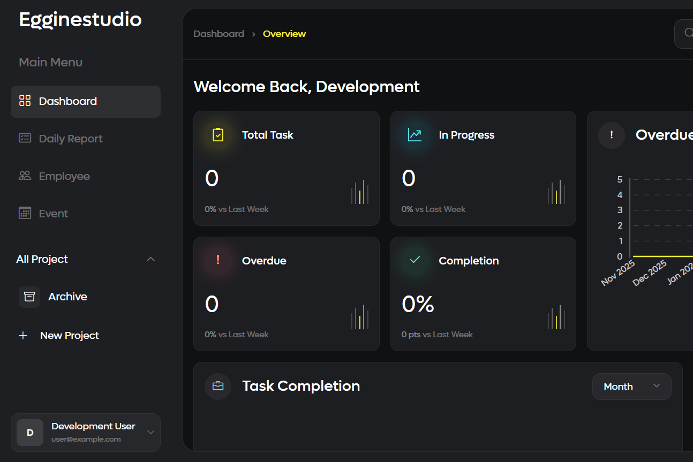

# Project Management Dashboard

Project management application with task assignment, team collaboration, a calendar, and daily reports.

**Status:** Local development; a public demo is not yet available.

## Preview

[](docs/screenshots/project-preview.png)

## Features

- Projects, team members, tasks, and status history
- Comments, attachments, and supporting task links
- Activity calendar, daily reports, and access settings

## Technology

Laravel 12, Vue 3, Inertia.js 2, Tailwind CSS, MySQL.

## Running Locally

Use PHP ^8.2, Composer, MySQL, and a Node.js version compatible with the bundler version in `package.json`.

```sh
composer install
npm ci
```

Copy `.env.example` to `.env`, create an empty database, and enter your local database configuration. Store email, OAuth, payment, and shipping credentials only in `.env`.

```sh
php artisan key:generate
php artisan migrate
php artisan storage:link
npm run build
php artisan serve
```

Open [localhost:8000](http://localhost:8000). Use a development database; real user data, uploads, and account credentials are not included. Seeders do not provide a fixed login password; configure your own development account.

External integrations require accounts and configuration for their respective services. Use sandbox mode where available.

## Structure

- `app/` — models, controllers, and application logic.
- `resources/` — views and frontend assets.
- `routes/` — application routes.
- `database/` — migrations, factories, and seeders.
- `tests/` — tests available in the project.

## Checks

Run `php artisan test` in a configured development environment. The presence of tests in the repository does not mean that all external integrations have been tested.

## Repository Notes

Installed dependencies, caches, `.env` files, databases, and user uploads are not included. Brand names and third-party assets remain subject to their respective owners' rights. This repository does not grant a license for reuse.
